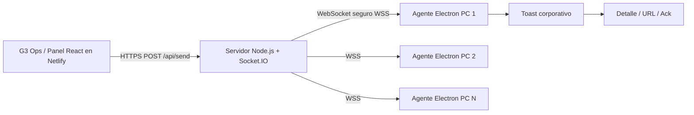

# Resumen de arquitectura

**Idea clave:** Netlify hospeda el panel React estático. El canal Socket.IO debe vivir en un servidor que mantenga conexiones persistentes (VM, contenedor o PaaS compatible). Electron se instala una vez en cada PC, arranca con Windows y permanece conectado aunque el navegador esté cerrado.
